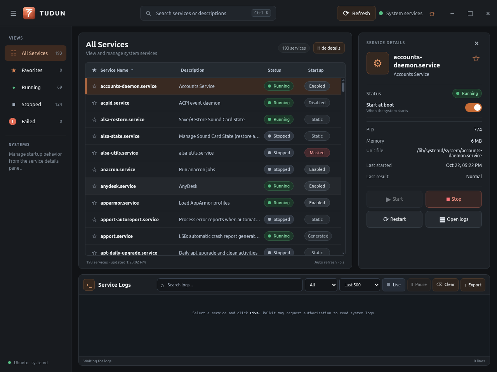

# TUDUN

TUDUN is a desktop application for viewing and managing systemd services on Ubuntu. It uses Electron for the interface and systemd tools for service status, actions, and logs.



[View the light theme](docs/screenshots/tudun-light.png).

## Features

- Browse, search, sort, and filter system services
- Mark services as favorites
- Start, stop, and restart services
- Create local service units and edit existing units or package-safe overrides
- Delete local service units after confirmation (stops and disables the service first)
- Enable or disable startup at boot
- Inspect service status, PID, memory use, unit file, and recent result
- Open per-service analysis with live CPU, memory, task counts, and short usage charts
- Read live or historical journal logs, filter them, and export them
- Switch between dark and light themes; collapse the navigation and details panels

Service actions, unit writes, and journal access use Polkit authorization through `pkexec`. The application itself runs as the current user. Saving a unit reloads systemd; it does not start, enable, or restart the service.

The **Analyze** button reads service-wide resource counters from cgroup v2 when available and falls back to systemd accounting properties on older hosts. CPU percentage is based on consecutive samples, where one fully used CPU core is 100%. Unavailable counters are shown as unavailable rather than estimated from an unrelated process.

## Install

For a packaged installation, download or build the `.deb` and follow [INSTALL.md](INSTALL.md). For development:

```bash
npm ci
npm start
```

The build machine needs Node.js 22.12 or newer, Python 3, and `dpkg-deb`. The packaged application includes Electron, so Node.js is not needed on the target machine.

## Build the Ubuntu package

```bash
npm ci
npm run package:deb
```

This creates `dist/tudun_1.2.0_amd64.deb` on an x64 Ubuntu build machine. To create the Jetson package on an x64 or arm64 Linux build machine:

```bash
npm run package:deb:arm64
```

The output is `dist/tudun_1.2.0_arm64.deb`. It targets JetPack 5 (Ubuntu 20.04) and JetPack 6 (Ubuntu 22.04) desktop installations. The arm64 package has not yet been run on a physical Jetson; see [INSTALL.md](INSTALL.md) for installation and device requirements.

## Project layout

```text
assets/icons/          Application icon
src/main/              Electron main process and systemd access
src/preload/           Narrow API exposed to the renderer
src/renderer/          HTML, CSS, and user interface behavior
packaging/linux/       Debian build script and desktop entry
scripts/               Source checkout launcher
docs/design-reference/ Original design references
docs/screenshots/       Application preview
```

See [INSTALL.md](INSTALL.md) for installation and troubleshooting and [docs/ARCHITECTURE.md](docs/ARCHITECTURE.md) for implementation details.
